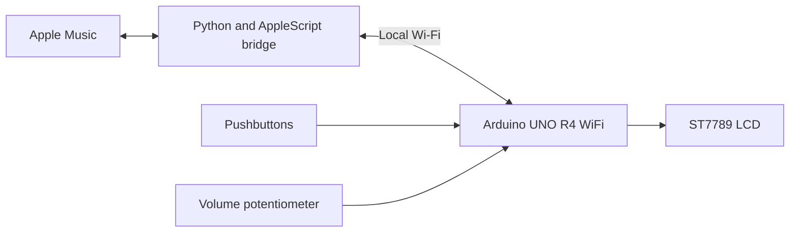

# Apple Music Desk Display

A wireless Apple Music controller and now-playing display built with an
Arduino UNO R4 WiFi and a 2-inch Waveshare ST7789 LCD. A small Python bridge on
macOS reads and controls Apple Music through AppleScript while the Arduino
handles the screen, buttons, and volume potentiometer.

## Features

- Current song, artist, playback state, and progress
- Album artwork streamed wirelessly from the Mac
- Alternating information and artwork views
- Physical next, play/pause, and previous buttons
- Potentiometer control for Apple Music volume
- Live volume percentage on the LCD
- No permanent USB connection after programming
- No SD card required

## How it works



The Mac extracts and resizes the current artwork, converts it to RGB565, and
serves it over the local network. A 220 by 220 RGB565 image requires 96,800
bytes, which is larger than the UNO R4's SRAM. The Arduino therefore receives
and draws one row at a time instead of storing the complete image.

## Hardware

- Arduino UNO R4 WiFi
- Waveshare 2-inch 240 by 320 ST7789 SPI LCD
- Three momentary pushbuttons
- 10 kOhm potentiometer
- Breadboard and jumper wires
- Suitable power supply or USB cable for programming

## Wiring

| Component | UNO R4 pin |
|---|---:|
| Next button | D2 |
| Play/pause button | D3 |
| Previous button | D4 |
| LCD backlight | D7 |
| LCD reset | D8 |
| LCD data/command | D9 |
| LCD chip select | D10 |
| LCD DIN/MOSI | D11 |
| LCD clock | D13 |
| Potentiometer center pin | A0 |

Each button connects its assigned digital pin to GND. The potentiometer's two
outside pins connect to 5V and GND, and its center pin connects to A0.

## Arduino libraries

Install these through the Arduino IDE Library Manager:

- Adafruit GFX Library
- Adafruit ST7735 and ST7789 Library
- ArduinoJson by Benoit Blanchon

`WiFiS3` and `SPI` are supplied by the Arduino UNO R4 board package.

## Arduino configuration

1. Open `arduino/AppleMusicDeskDisplay/`.
2. Duplicate `arduino_secrets.example.h`.
3. Rename the duplicate to `arduino_secrets.h`.
4. Enter the Wi-Fi name, password, and Mac's local IPv4 address in that file.
5. Open `AppleMusicDeskDisplay.ino` in Arduino IDE.
6. Select **Arduino UNO R4 WiFi** and upload the sketch.

Example private configuration:

```cpp
#define SECRET_WIFI_NAME "YOUR_WIFI_NAME"
#define SECRET_WIFI_PASSWORD "YOUR_WIFI_PASSWORD"
#define SECRET_BRIDGE_IP 192, 168, 1, 100
```

The real `arduino_secrets.h` is ignored by Git, preventing network credentials
from being uploaded.

To find the Mac's local Wi-Fi address, run:

```bash
ipconfig getifaddr en0
```

## Mac bridge setup

The bridge requires macOS, Python 3, Pillow, and permission to control Music.

```bash
cd mac-bridge
python3 -m pip install --user -r requirements.txt
python3 apple_music_bridge.py
```

Keep the bridge running while using the display. The Mac and Arduino must be on
the same trusted local network. The bridge listens on port `8765` and does not
provide authentication, so it should not be exposed directly to the internet.

## Repository contents

- `arduino/AppleMusicDeskDisplay/`: Arduino firmware
- `mac-bridge/`: Python and AppleScript bridge
- `images/`: project photographs or demonstration media

## Possible future improvements

- Automatically discover the Mac instead of entering its IP address
- Launch the bridge automatically when the user logs in
- Add custom fonts with broader Unicode support
- Design and 3D-print a permanent enclosure

## Disclaimer

This is an independent educational project and is not affiliated with or
endorsed by Apple, Arduino, Adafruit, or Waveshare. Apple Music is a trademark
of Apple Inc.
